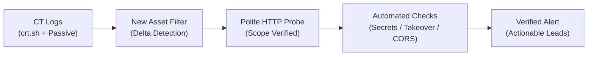

<div align="center">


<a href="https://difano.vercel.app">
  
</a>

<br /><br />


<a href="https://difano.vercel.app"></a>
<a href="https://difano.hollyverse.xyz"></a>


</div>

---

## About & Mindset

<table>
<tr>
<td width="54%" valign="top">

**Josua Zxz** (`@JosuaZxz`), developer &amp; tinkerer based in **Yogyakarta, Indonesia**.

I like turning messy ideas into fast, reliable systems across four overlapping worlds:

- **Web & AI Engineering:** Full-stack TypeScript/React apps paired with AI-first automation & developer tooling.
- **Programmatic Media:** Building cel-shaded 3D/2D storytelling & audio DSP workflows (`ricks-clip-skill`).
- **Server Infrastructure:** High-concurrency server setup, plugin optimization, and network ops at [Pryafix](https://pryafix.web.id/) & [Biibschool](https://web.bibschool.my.id/).
- **Security Research:** Ethical vulnerability hunting on HackerOne (`ch4rsec`) and passive recon automation (`Nova-Recon`).

</td>
<td width="46%" valign="top">

```json
{
  "name": "Josua Zxz",
  "handle": "@JosuaZxz",
  "base": "Yogyakarta, ID",
  "security": "ch4rsec @ HackerOne",
  "infra": ["Pryafix", "Biibschool"],
  "focus": [
    "Full Stack Systems",
    "AI-First Workflows",
    "3D Motion Tooling",
    "Asset Reconnaissance"
  ],
  "status": "open_to_collaborations"
}
```

</td>
</tr>
</table>

---

## Contribution Activity

<div align="center">
  <picture>
    <source media="(prefers-color-scheme: dark)" srcset="https://raw.githubusercontent.com/JosuaZxz/JosuaZxz/output/github-contribution-grid-snake-dark.svg" />
    <source media="(prefers-color-scheme: light)" srcset="https://raw.githubusercontent.com/JosuaZxz/JosuaZxz/output/github-contribution-grid-snake.svg" />
    
  </picture>
</div>

---

## Tech Stack

<div align="center">

**Languages, Web & Media**


<br /><br />

**Backend, Automation & Tooling**


</div>

---

## GitHub Telemetry

<div align="center">
  
  
</div>

---

## Selected Work & Recon Pipeline

| Project | Description | Domain |
| :--- | :--- | :--- |
| **[`ricks-clip-skill`](https://github.com/JosuaZxz/ricks-clip-skill)** | Agent skill and runnable 2.5D/3D cel-shaded Remotion + Three.js pipeline for 9:16 explainer Shorts with Fish Audio TTS, Whisper sync, and `-15.0 LUFS` DSP audio. | `TypeScript` · `Remotion` · `Three.js` · `Python` |
| **[`Nova-Recon`](https://github.com/JosuaZxz/Nova-Recon)** | Scheduled bug bounty reconnaissance engine powered by Certificate Transparency logs and GitHub Actions for new-asset verification. | `Python` · `AppSec` · `GitHub Actions` |
| **[`Pryafix`](https://pryafix.web.id/)** | Community Minecraft infrastructure architecture, plugin performance tuning, and server hardening. | `Infrastructure` · `Optimization` |
| **[`Biibschool`](https://web.bibschool.my.id/)** | Developer supporting backend infrastructure, runtime stability, and server systems. | `Systems` `Backend` |

<details>
<summary><b>View Featured Visual Output (ricks-clip-skill) &amp; Nova-Recon Pipeline</b></summary>
<br />

<div align="center">
  <a href="https://github.com/JosuaZxz/ricks-clip-skill">
    
  </a>
</div>

<br />



</details>

---

## Connect

- **Portfolio:** [difano.vercel.app](https://difano.vercel.app) · [difano.hollyverse.xyz](https://difano.hollyverse.xyz)
- **GitHub:** [@JosuaZxz](https://github.com/JosuaZxz)
- **HackerOne:** `ch4rsec`
- **Availability:** Open to Full Stack web engineering, AI workflow integration, and server infrastructure collaborations (`2025 / 2026`).

<div align="center">
  
</div>
